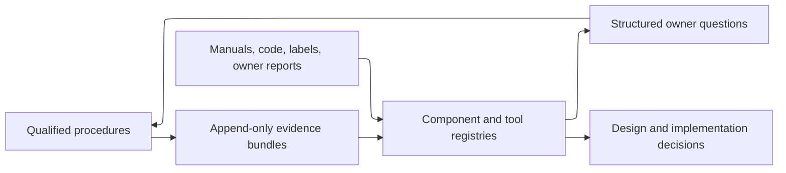

# US-002: Hardware, Workshop, Manuals, And Evidence

## User Story

As the robot's builder and an engineer developing electronics and mechanical
skills, I want every robot component and available workshop tool precisely
catalogued so that agents can propose feasible designs, recognize reusable
equipment, explain safe procedures, and avoid asking me to obtain tools or
parts I already own.

## Why This Story Exists

The repository has a broad parts list, several vendor manuals, useful mechanical
notes, and a concise current BOM. It does not yet reliably answer:

- which exact product variant is physically installed;
- which items are available inventory rather than active robot components;
- which documented parts are legacy;
- how modules are electrically and mechanically connected as built;
- which measurement, assembly, cutting, drilling, and fabrication capabilities
  are available to solve a problem;
- which claims come from a vendor manual, owner report, code assumption, or
  physical measurement;
- which evidence qualified a hardware fact.

This prevents agents from fully using the owner's workshop and creates a risk
of selecting incorrect manuals, voltage assumptions, interfaces, fasteners, or
fabrication procedures.

## Information Flow



## Current Known Inventory

### Core robot components documented today

- Raspberry Pi Pico 2 W.
- ESP32-DevKitC-class board; exact installed board/module variant remains to be
  confirmed.
- Two Pololu 37D 30:1 gearmotors with encoders.
- Cytron MDD10A motor driver.
- 4S2P LiFePO4 battery pack.
- DALY-family BMS with conflicting model descriptions.
- Panther iQLoad EVO 5 charger.
- Tracked suspension chassis.
- Xbox-compatible controller path through ESP32/Bluepad32.

### Documented sensors and available components

- HC-SR04 ultrasonic sensors.
- VL53L0X time-of-flight sensor modules.
- DYP-A02-V2.0 waterproof ultrasonic sensor.
- Breadboards, prototyping PCBs, connector kits, wire, fasteners, brackets,
  washers, FR-4, ABS, foam, and other workshop materials.

### Documented workshop tools

- PeakTech 3350 digital multimeter.
- RUZIZAO adjustable 0-30 V / 0-10 A bench power supply.
- Yihua 898BD soldering and hot-air station.
- iCRIMP micro-connector crimping tool.
- Wiha side cutters and general plier sets.
- Cutting-disc and file sets.
- Baer tap and drill set.
- Digital protractor.
- Face shield and assorted electrical/fabrication consumables.

This list is a discovery seed, not proof that each item is present, complete,
safe to use for a proposed task, or represented by the correct exact model.
The current machine-readable state is in `../../reference/component-registry.yaml`
and `../../reference/tool-registry.yaml`; this backlog summary is not an inventory
database.

## Required Artifact Vocabulary

| Artifact | Meaning |
| --- | --- |
| Schematic | Logical electrical connections, devices, rails, protection, signal names, and component values |
| Wiring/harness diagram | Physical connector-to-connector wiring, pin numbers, colors, gauges, lengths, routing, and termination |
| PCB layout | Footprints, copper, vias, stack-up, and board implementation |
| Mechanical drawing/CAD | Geometry, mounting, material, tolerance, clearance, and load-relevant information |
| As-built record | What the current physical robot contains, including deviations from design |
| Component documentation | Searchable project-specific summary linked to authoritative source material |
| Tool record | Capability, limits, accessories, condition, familiarity, and safe use of a workshop or development tool |
| Evidence bundle | Immutable record of the procedure, system identity, raw artifacts, observations, and result |

A pin table is not a substitute for a schematic, and a schematic is not proof of
as-built wiring. All may be required for a control- or power-critical decision.

## Fact States

Hardware and tool facts use the shared `US-001` vocabulary plus these inventory
states:

- `Verified installed`;
- `Owner reported installed`;
- `Documented / unverified`;
- `Available inventory`;
- `Planned`;
- `Legacy`;
- `Conflicting identity`;
- `Suspected missing from documentation`;
- `Unknown`.

An item can have separate identity, installation, connection, and functional
states. For example, a sensor may be identity-verified and available while not
installed or functionally tested.

## Component Registry Contract

The machine-readable registry lives at
`docs/reference/component-registry.yaml`. Each physical item or homogeneous
set receives a stable, human-readable ID. Its versioned JSON Schema lives in
`docs/reference/schemas/`.

```yaml
id: component-human-readable-id
category: controller | power | actuator | sensor | interface | mechanical | consumable
manufacturer: exact-or-null
model: exact-or-null
variant: exact-or-null
quantity: 1
states:
  identity: owner-reported
  inventory: available
  installation: owner-reported
  connection: conflicting
  functional: implemented
system_role: concise purpose
owner_subsystem: pico | esp32 | android | shared-hardware | workshop
software_links: []
safety_constraints: []
known_failure_modes: []
claims:
  - key: electrical.example
    value: unknown
    state: conflicting
    provenance:
      - source_id: source-id
        locator: page, section, code symbol, or observation
question_ids: []
```

Identity, inventory, installation, connection, and functional state are
separate because one dimension must not silently qualify another. Every
decision-relevant claim has its own provenance. Global source lists are
navigational only and cannot prove an individual voltage, pin, model, or
capability.

Required human-readable documentation should live at
`docs/reference/components/<component-id>.md` and explain:

- what the component does in this robot;
- why the selected variant matters;
- how it is powered and connected;
- what code depends on it;
- what must be measured or configured;
- common failure symptoms;
- replacement and compatibility considerations;
- verified facts, owner reports, conflicts, and remaining questions.

Do not create a documentation for generic low-risk consumables unless their material,
rating, or compatibility materially affects a decision.

## Workshop Capability Registry

The registry lives at `docs/reference/tool-registry.yaml`. The
purpose is not only inventory. It allows an agent to choose feasible procedures
and notice useful capabilities the owner may not think to apply.

```yaml
id: tool-id
category: measurement | electronics-assembly | fabrication | hand-tool | safety | software-interface
manufacturer: exact-or-unknown
model: exact-or-unknown
availability: available | incomplete | needs-consumable | unavailable | unknown
condition: working | needs-check | damaged | unknown
capabilities: []
ranges_and_accuracy: []
compatible_materials: []
accessories: []
owner_familiarity: expert | comfortable | learning | unknown
safety_requirements: []
suitable_robot_tasks: []
unsuitable_tasks: []
source_assets: []
owner_reports: []
evidence_ids: []
```

### Measurement and diagnostics

Record, where available:

- multimeters and probe accessories;
- bench power supplies and current-limit behavior;
- oscilloscopes and probes;
- logic analyzers;
- SWD/JTAG/debug probes;
- USB/UART adapters;
- current, battery, temperature, and power measurement equipment;
- calipers, rulers, angle gauges, protractors, and scales.

For measurement tools, capture range, resolution, relevant accuracy, category
rating, isolation limitations, fuse state where applicable, and whether the
measurement procedure stays within those limits.

### Electronics assembly

Record:

- soldering and hot-air stations;
- iron tips, nozzles, solder, flux, braid, and extraction;
- crimpers, dies, wire strippers, and connector insertion/removal tools;
- breadboards, prototyping PCBs, test leads, clips, and jumpers;
- heat-shrink, insulation, sleeving, and cable-management supplies.

### Cutting, drilling, and fabrication

Record:

- drills, drill drivers, rotary tools, and drill stands;
- chuck capacity, speed control, and available bit types/sizes;
- cutting wheels, saws, blades, and their supported materials;
- taps, dies, files, deburring, sanding, and finishing tools;
- vises, clamps, jigs, sacrificial backing, and other workholding;
- pliers, wrenches, screwdrivers, side cutters, and torque tools;
- any 3D printer, CNC, laser, or externally available fabrication service.

For each fabrication tool, document material compatibility, maximum practical
thickness or capacity, required workholding, debris/heat hazards, and PPE. An
agent must not treat ownership of a cutting disc as proof that a proposed cut is
safe or accurate.

### Materials, fasteners, and consumables

Record useful stock and constraints:

- metals, plastics, FR-4, foam, rubber, and adhesive materials;
- wire conductor material, gauge, insulation, temperature, and current-relevant
  limitations;
- screws, nuts, washers, spacers, inserts, and connector families;
- adhesives, tapes, insulation, solder, heat-shrink, and abrasion protection;
- battery construction supplies only with explicit safety constraints.

### Safety equipment

Record:

- eye and face protection;
- hearing and respiratory protection where relevant;
- solder-fume extraction and ventilation;
- gloves appropriate to the task, noting tasks where gloves create entanglement
  risk;
- fire protection and battery-safe work surfaces/storage;
- insulation, guards, and emergency disconnect equipment.

Absence of required safety equipment is a blocking precondition, not a reason
to weaken the procedure.

### Development and interface equipment

Record:

- USB cables, hubs, adapters, and power supplies;
- Android test devices;
- game controllers;
- programmers and debug probes;
- serial adapters and which voltage levels they support;
- computers or remote systems used for builds, simulation, or training.

## How Agents Must Use The Workshop Inventory

For any physical proposal, an agent must:

1. Identify the required measurement, assembly, fabrication, and safety
   capabilities.
2. Compare them with the tool registry.
3. Prefer a safe approach achievable with available tools when it does not
   compromise the result.
4. Explain which existing tools are useful and why.
5. State tool accuracy, capacity, or material limitations.
6. Identify missing accessories or consumables.
7. Recommend acquiring equipment or using professional fabrication when the
   available setup is unsuitable.
8. Adapt instructions to the owner's recorded familiarity.
9. Provide workholding, PPE, expected result, and stop conditions.
10. Retain measurements or photographs that materially affect later decisions.

Agents should proactively notice opportunities such as:

- using the bench PSU current limit during first power-up;
- using continuity checks before energizing wiring;
- using the digital protractor to verify bracket or sensor alignment;
- using available FR-4 or ABS for a non-conductive adapter when mechanically
  appropriate;
- using a crimper and correct connector family instead of unreliable loose
  jumpers;
- using files and deburring tools after drilling or cutting;
- using existing clamps or recommending them before drilling small workpieces.

These are examples, not pre-approval for a particular operation.

## Interactive Discovery And Owner Interview

### Discovery before questions

The responsible agent first extracts candidate items from:

- `docs/reference/bom-and-parts-status.md`;
- `docs/reference/source-index.md`;
- the complete component list and component PDF;
- electrical and mechanical assets;
- firmware pin configuration and hardware drivers;
- build, flash, and bench procedures;
- repository photos;
- connected USB/serial metadata;
- prior owner answers and evidence records.

It then deduplicates names and separates installed hardware from available
inventory, tools, materials, and legacy parts.

### Question record

The live queue and schema are implemented at
`../../verification/questions/US-002.yaml` and
`../../reference/schemas/question-registry.schema.json`. The following shape is
retained as the contract:

```yaml
id: Q-US002-001
suspected_item: concise name
known_context: why the project believes it exists
question: one precise request
reason: why identity or capability changes a decision
impact: safety | compatibility | procedure | documentation
preferred_evidence: text | label-photo | full-photo | purchase-link | manual | measurement
acceptable_fallback: owner description if stronger evidence is unavailable
status: open
```

Questions should be sent in small, related batches ordered by safety impact:

1. Battery, BMS, charger, fusing, power switching, and high-current wiring.
2. Controllers, motor driver, motors, encoders, and logic voltage.
3. Installed sensors, communications, and connectors.
4. Measurement and debugging tools.
5. Soldering, crimping, cutting, drilling, workholding, and PPE.
6. Materials, fasteners, consumables, and future inventory.

Typical requests include:

- exact text and photographs from the ESP32 board and module;
- BMS front/rear label and connector photographs;
- motor order number, ratio, encoder variant, and supply measurement;
- charger model, firmware if any, and selected battery chemistry program;
- drill type, chuck size, speed control, stand, and bit inventory;
- rotary-tool model and cutting-disc specifications;
- whether a vise, clamps, or sacrificial backing are available;
- multimeter current range, fuses, probes, and clips;
- undocumented oscilloscope, logic analyzer, debugger, or UART adapter;
- ventilation, face/eye protection, and fire readiness;
- available materials and connector families.

Text answers are accepted and retained as `Owner reported`. Photos, manuals, or
measurements should be requested only when they materially improve identity,
compatibility, or safety. Never infer an exact model merely because a product
looks similar.

### Owner Input Required: initial hardware and workshop queue

The tables below preserve the initial discovery snapshot. Status changes,
answers, new questions, and evidence links belong only in the live YAML queue,
which also contains `Q-US002-016` through `Q-US002-019` for motor-control
wiring, charger-current compatibility, installed cells, and the emergency
disconnect. Ask these in the listed batches rather than as one large interview. Later
questions should be generated from the answers and physical evidence instead
of assuming that every item in the historical component list is still present.

#### Batch A: current power and control hardware

| ID | Question | Why it matters | Preferred evidence | Status |
| --- | --- | --- | --- | --- |
| `Q-US002-001` | What exact manufacturer/model and label text appear on the installed BMS? | Existing sources conflict on supported cell count, current rating, balancing, and interfaces | Clear front/rear label and connector photos; text is acceptable initially | `Open` |
| `Q-US002-002` | What voltage is actually supplied to each motor encoder, and what signal voltage is observed on A/B? | Current notes conflict with the documented encoder supply requirement | Multimeter measurement with named points and power state | `Open` |
| `Q-US002-003` | Which Pico pins are physically connected to the left encoder? | Documentation says `GP12/13`; a live code path says `GP20/21` | Continuity results plus annotated connector/wire photo | `Open` |
| `Q-US002-004` | What exact ESP32 development-board and module markings are installed? | Board variant affects pin availability, USB/UART behavior, build target, and electrical assumptions | Board front/rear photos and printed markings | `Open` |
| `Q-US002-005` | What exact part/order markings are visible on both motors and the Cytron driver revision? | Confirms gearbox, encoder, current, mounting, and driver assumptions | Label/board photos or purchase records | `Open` |
| `Q-US002-006` | What fuse, disconnect, switch, connector, and wire-gauge arrangement exists between pack, BMS, driver, and controllers? | Determines safe first-power and emergency-disconnect procedures | Annotated as-built photos and owner description | `Open` |
| `Q-US002-007` | What exact charger model and LiFePO4 program/settings are currently used? | Charge termination and cell compatibility are safety-critical | Charger label/display photos and manual | `Open` |

#### Batch B: measurement and electronics tools

| ID | Question | Why it matters | Preferred evidence | Status |
| --- | --- | --- | --- | --- |
| `Q-US002-008` | Are the PeakTech 3350 and RUZIZAO bench supply still available and working, and which probes/leads/clips are available? | Determines which voltage, continuity, current-limit, and current measurements are feasible | Owner report; photos if model or accessories differ | `Open` |
| `Q-US002-009` | Do you own an oscilloscope, logic analyzer, SWD/JTAG probe, USB-UART adapter, clamp meter, thermometer, or other measurement/debug tool not listed? | These can close important firmware/hardware feedback loops | Model names and available probes/accessories | `Open` |
| `Q-US002-010` | What soldering, hot-air, fume-extraction, crimping, wire-stripping, and connector-depinning equipment is currently usable? | Determines whether harness and board rework can be recommended safely | Tool models/accessories and owner familiarity | `Open` |

#### Batch C: cutting, drilling, fabrication, and safety

| ID | Question | Why it matters | Preferred evidence | Status |
| --- | --- | --- | --- | --- |
| `Q-US002-011` | Which drill, drill-driver, rotary tool, drill stand, and bit sizes/materials are available? | Enables feasible bracket, adapter, enclosure, and mounting recommendations | Model/capacity plus bit and accessory inventory | `Open` |
| `Q-US002-012` | Which saws, cutting discs, files, taps, sanding/deburring tools, vises, and clamps are available and working? | Cutting accuracy and safety depend on material-compatible tooling and workholding | Owner report with photos where convenient | `Open` |
| `Q-US002-013` | What stock materials, fasteners, spacers, inserts, adhesives, and connector families are actually on hand today? | Lets agents reuse inventory and avoid proposing unavailable dimensions or materials | Approximate organized inventory; exact counts are unnecessary | `Open` |
| `Q-US002-014` | What eye/face protection, ventilation/fume extraction, fire protection, battery-safe work surface/storage, and emergency disconnect equipment are available? | Missing safety equipment can block soldering, cutting, drilling, charging, or powered testing | Owner report and relevant equipment identity | `Open` |
| `Q-US002-015` | For drilling, cutting, soldering, crimping, and electrical measurement, where would you rate your current familiarity? | Procedures should add detail where useful without over-explaining familiar work | `Comfortable`, `learning`, or `new` per activity | `Open` |

## Manual And Source Policy

Original PDFs remain valuable and should be preserved because they retain:

- revision and product identity;
- diagrams and layout relationships;
- tables and footnotes;
- safety warnings;
- vendor context that automated extraction can lose.

Curated Markdown should be added for searchability and agent context. It should
extract only project-relevant information:

- exact identity and applicable variant;
- ratings and absolute limits;
- pinout and connectors;
- protocol and configuration;
- installation and maintenance constraints;
- safety warnings and known incompatibilities.

Each extracted claim should cite the original filename and page or section.
OCR-derived values remain `Documented / unverified` until checked against the
rendered PDF or physical hardware. Do not reproduce an entire copyrighted
manual. If the exact manual is unavailable, request the model, purchase link,
PDF, or label photographs before selecting a likely manual.

## Electrical And As-Built Target Structure

Durable artifacts use:

```text
docs/reference/component-registry.yaml
docs/reference/tool-registry.yaml
docs/reference/source-registry.yaml
docs/reference/components/<component-id>.md
docs/reference/tools/<tool-id>.md
docs/assets/...
docs/verification/questions/US-002.yaml
docs/electrical/design/robot-system.kicad_sch
docs/electrical/as-built/<hardware-revision>/...
docs/verification/evidence/<evidence-id>/...
```

The electrical design should cover at minimum:

- battery, BMS, charger, fuse/protection, disconnect, and power distribution;
- motor-power path and driver connections;
- Pico and ESP32 supplies and grounding;
- motor driver PWM/DIR interfaces;
- encoder supplies and signal levels;
- debug and controller UARTs;
- connector IDs, pin numbers, net names, and voltage domains.

The as-built record should include revision, dated annotated photographs,
deviations from the schematic, connector/harness identity, wire gauge/color
where known, and the evidence that qualified it.

## Evidence Bundle Contract

Evidence uses the implemented append-only directory contract and metadata
schema under `../../verification/evidence/` and `../../reference/schemas/`:

```text
docs/verification/evidence/EV-YYYY-NNN/
  metadata.yaml
  procedure.md
  result.md
  raw/
  photos/
```

Required metadata:

- evidence ID and date;
- operator and whether observations were agent- or owner-performed;
- robot, electrical, harness, and mechanical revision;
- Android, ESP32, and Pico Git SHAs where relevant;
- configuration and calibration identity;
- instruments and tool IDs;
- measurement points and conditions;
- expected value/tolerance;
- observed value;
- pass, fail, or inconclusive result;
- linked backlog, issue, decision, and component IDs;
- retained raw artifacts.

Editing an old evidence result to match a later build is prohibited. Create a
new evidence ID and retain the superseded record.

## Initial Verification Priorities

1. Identify the exact installed BMS from physical labels and wiring.
2. Confirm left encoder pins by continuity and live signal observation.
3. Measure actual encoder supply and signal voltage.
4. Confirm charger model and LiFePO4 termination/configuration behavior.
5. Confirm motor, gearbox, encoder, and driver variants.
6. Record power protection, emergency disconnect, and motor-test setup.
7. Audit measurement and fabrication tools needed for migration and mounting
   work.

These items are higher priority than documenting unused sensor inventory
because they affect present control and electrical safety.

## Implementation Stages

1. **Implemented:** parse existing sources into provisional component, tool,
   material, consumable, legacy, and missing-documentation records.
2. **Implemented:** assign stable IDs, separate state dimensions, and
   claim-level provenance.
3. **Implemented:** create the prioritized machine-readable owner-question
   queue.
4. **Active / owner-assisted:** record responses without overstating
   verification.
5. **Implemented foundation:** create component, tool, and source registries,
   schemas, validation, and priority documentation/manual summaries.
6. **Blocked by identity evidence and KiCad availability:** capture the first
   as-built revision and system schematic.
7. **Procedures implemented; execution approval-gated:** run unpowered identity
   and continuity evidence before any powered procedure.
8. **Active as evidence arrives:** link verified facts into architecture,
   wiring, bring-up, and known-issue documentation.
9. **Implemented as contract:** future hardware additions update registry,
   source, interfaces, evidence, and as-built state together.

Validate the repository-owned records with:

```text
python3 tools/docs/validate_us002_records.py
python3 -m unittest discover -s tools/docs/tests -v
```

## Acceptance Criteria

- Every installed control- or power-critical component has an exact identity or
  a clearly visible blocking question.
- Installed, available, legacy, and proposed items cannot be confused.
- Agents can answer what measurement, electronics, cutting, drilling,
  fabrication, workholding, materials, and PPE capabilities are available.
- A proposed physical procedure names suitable available tools, limitations,
  safe setup, expected output, and stop conditions.
- Original manuals remain available and curated facts are source-linked.
- The electrical design and as-built record are explicitly separate.
- BMS, encoder pin, and encoder supply conflicts are resolved or remain visible
  blockers with next evidence steps.
- Evidence identifies the hardware and software state it actually qualified.

## External Evidence And Practices

| Source | Practice adopted | Applicability limit |
| --- | --- | --- |
| [RoboParty RP1](https://github.com/Roboparty/RP1) | First-class mechanical sources, schematics, PCB files, BOM, assembly procedures, firmware, and full-machine testing | Young project; artifact organization is more useful here than process maturity |
| [Zephyr](https://github.com/zephyrproject-rtos/zephyr) | Machine-readable board/peripheral descriptions and hardware-aware tests | The robot needs a smaller custom schema, not Zephyr's full board ecosystem |
| [PX4 testing](https://docs.px4.io/main/en/test_and_ci/index) | Separation of unit, simulation, integration, hardware bench, HIL, and live qualification | Tracked robot has lower system scale but still needs distinct evidence levels |
| [EmbedGym](https://arxiv.org/abs/2611.21845) | Circuit netlists, pin mappings, timed stimuli/assertions, and final physical-board verification | Simulation cannot prove the as-built robot or power path |
| [IoT-SkillsBench](https://openreview.net/pdf?id=RsDq8WgRVG) | Compact expert-authored skills capturing initialization constraints and known failure modes | Research tasks are narrower than full robot integration |

## Remaining Risks

- Some exact products may no longer have labels, receipts, or authoritative
  manuals.
- The complete component list mixes current, legacy, available, and aspirational
  items.
- A tool may be owned but lack accessories, safe workholding, calibration, or
  sufficient accuracy.
- Cataloguing everything can become busywork; prioritize active, safety-relevant,
  and decision-relevant items.
- Owner-reported facts are useful but must not be silently presented as bench
  verification.
