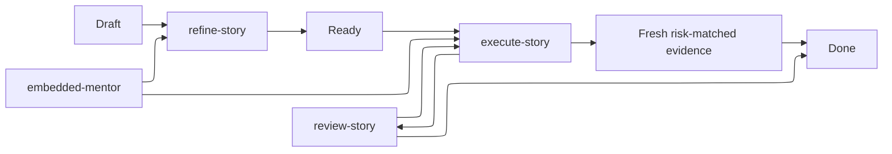

# US-004: Lightweight Agentic Development Harness

## User Story

As the robot's owner and solo developer, I want a lightweight repository-owned
agentic development harness so that stories can be refined, implemented,
reviewed, learned from, and completed with evidence appropriate to embedded and
physical-system risk.

## Outcome

Replace the team-sized lifecycle with stable story records, a generated summary
index, four focused skills, concise embedded mentoring, useful Mermaid+ELK
diagrams, and validation that prevents status or dependency drift.

## Current And Target Behavior

### Current

The repository has strong ownership, risk, evidence, and approval contracts but
uses separate Refined and Verification states. It has no repository-local
skills, generated story index, story schema, or Mermaid convention.

### Target

Use `Draft -> Ready -> In Progress -> Done`, with Blocked and Deferred escape
states. Refinement is the activity that produces Ready; verification occurs
during In Progress and gates Done.

## Ownership Boundary

This story changes parent-workspace process, documentation, validation, and
agent skills only. Android, ESP32, and Pico retain their existing implementation
and safety responsibilities.

## Dependencies And Non-Goals

- US-001 blocks this story because its ownership and collaboration contract is
  the baseline.
- US-002 and US-003 inform hardware and verification behavior without blocking
  parent-process implementation.
- Persistent specialist-agent personas, formal eval infrastructure, and
  per-story PDF generation are non-goals for v1.

## Risks, Unknowns, And Owner Questions

- Excess ceremony would reduce use; status and template requirements stay small.
- Weak completion semantics could overstate physical qualification; Done
  retains fresh, claim-matched evidence requirements.
- Mermaid renderer versions differ; diagrams declare ELK explicitly while CI
  validates source structure without adding a browser runtime.

## Acceptance Criteria

- [x] The simplified lifecycle and dependency semantics are canonical.
- [x] Existing stories use stable paths and machine-readable front matter.
- [x] The backlog index is generated and checked for drift.
- [x] Refinement, execution, review, and embedded-mentor skills are discoverable.
- [x] Mermaid diagrams declare ELK when structurally useful.
- [x] Backlog validation runs in CI and has focused unit tests.
- [x] Active agent instructions and contracts point to the new harness.

## Evidence Plan

- Static: schema, validator, skill validation, Python compilation, link checks.
- Runtime/device: not applicable; no platform or device behavior changes.
- Bench or physical: not applicable.
- Documentation: generated-index equality and consistency review.

## Diagram

## Learning Notes

The software lifecycle remains useful, but embedded claims have levels. A unit
test can qualify parsing logic; it cannot qualify voltage levels, timing on the
installed harness, motor stop behavior, or mechanical fit. The harness keeps
one lifecycle while making the evidence ladder explicit.

## Progress And Evidence

Implemented in the parent workspace without platform-code or physical-system
changes. Verified on 2026-11-19 with:

- `python3 -m unittest discover -s tools -p 'test_*.py' -v` — 18 tests passed;
- `python3 tools/docs/validate_backlog.py` — four stories valid;
- `python3 tools/docs/validate_us002_records.py` — component, tool, source,
  question, evidence, generated-index, and local-link contracts valid;
- `python3 -m py_compile tools/docs/validate_backlog.py tools/robot.py tools/robotlib/core.py`;
- `quick_validate.py` for each of the four repository skills;
- `git diff --check`.

Device, bench, HIL, and motion checks were not run because this story changes
only parent documentation, process, skills, and host validation.
