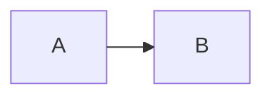

# Backlog Workflow

## Purpose

Keep robot work understandable, implementable, and historically traceable with
the least process that still protects subsystem boundaries and physical safety.
The backlog index is generated from stable story directories in `items/`.

## Lifecycle


Refinement and verification are activities, not backlog states. Refinement
completes the definition; planning creates the executable plan and turns a
`draft` into `ready`. Implementation, testing, device use, bench work,
review, and evidence collection happen during `in-progress`. A story becomes
`done` only after the evidence needed for its claims exists.

| Status | Meaning and exit condition |
| --- | --- |
| `draft` | A stable ID, title, user story, and initial outcome exist. Refine it before implementation. |
| `ready` | The Definition of Ready is satisfied. Informational dependencies may remain active. |
| `in-progress` | Blocking dependencies are done and implementation owns the work. Testing and evidence are part of this state. |
| `blocked` | The previous state, blocking fact, owner, and unblock condition are recorded. |
| `done` | Acceptance criteria and the Definition of Done are satisfied with fresh evidence. |
| `deferred` | The reason and concrete reactivation trigger are recorded. |

Story paths never change with status. This keeps links stable and lets Git
history show how understanding and evidence evolved.

## Risk Classes

| Class | Typical work | Minimum treatment |
| --- | --- | --- |
| `tiny` | Local docs, obvious cleanup, isolated test | Intent, boundary, and focused check |
| `normal` | Non-trivial work without safety-authority changes | Current/target behavior, ownership, non-goals, and platform checks |
| `safety-control` | Motion, stop/recover, encoder, wiring, battery, power, fabrication, or control authority | Failure modes, safe setup, approval gates, stop conditions, and bench evidence plan |
| `future-autonomy` | Perception or autonomy that can influence motion | Safety/control treatment plus confidence, stale-input, contradiction, bounded admission, and manual override |

Individual operations inherit the highest applicable risk even when the parent
story is process or tooling work.

## Definition Of Ready

- Definition refinement is complete and `implementation-plan.md` has passed review.
- The user or system outcome is clear.
- Current and desired behavior are separated.
- The owning subsystem and affected boundaries are identified.
- Risk is classified.
- Blocking and informational dependencies are distinguished.
- Conflicts, owner questions, assumptions, dependencies, and non-goals are explicit.
- Available components, tools, skills, and verification paths were considered.
- Acceptance criteria and evidence depth are defined.
- Required human approvals and physical interventions are known.
- A Mermaid diagram with explicit ELK layout exists when structure, sequence,
  timing, wiring, dependencies, or three or more interacting elements are
  materially clearer visually.
- Decision-relevant embedded learning needs are identified.
- The task DAG covers every acceptance criterion and records repositories,
  subsystems, test mode, doubles/limitations, evidence level, and parallel safety.
- Pattern analysis records reuse, extend, adapt, replace, or no precedent.

`ready` means decision-complete. It does not mean every informational
dependency is finished. A story may enter `in-progress` only after dependencies
marked `blocks` are `done`.

## Progressive Qualification And Unknown Activation

Open registry questions are routing aids, not a mandatory pre-story checklist.
They remain dormant until a concrete acceptance criterion, task, or safety gate
depends on them. Do not make a story wait for exact identity, dimensions,
wiring, settings, or condition that cannot change its current decisions.

During refinement or planning, activate only the smallest unknown needed for a
specific decision and attach it to the first dependent task. During execution,
ask the owner just in time for an unavailable physical observation or
measurement, retain it with story evidence, and update the shared hardware
documentation. A task may be blocked while independent tasks continue; block
the story only when the activated unknown prevents every remaining required
path. Physical approval and safe-state gates still apply at the operation that
can energize, move, cut, drill, charge, or otherwise create risk.

## Definition Of Done

- Implementation matches the approved ownership boundary.
- Acceptance criteria are checked against the resulting behavior.
- Relevant builds, tests, lint, and static checks pass with fresh output.
- Required runtime, device, bench, or motion evidence is retained or the story
  remains open.
- Build success is not presented as device or physical qualification.
- Failure, stop, recovery, and degraded behavior are verified when relevant.
- Shared docs and platform docs agree with implementation.
- Remaining uncertainty is explicit rather than hidden.
- Reusable lessons become tests, concise learning notes, checklists, or decisions.
- A known-good integrated snapshot is recorded when system behavior changes.

## Dependencies

Each dependency has an ID and one of two kinds:

- `blocks`: the dependency must be `done` before this story enters
  `in-progress`.
- `informs`: its evolving results affect this story, but safe independent work
  may proceed.

Blocking dependency cycles are invalid. Dependencies never replace explicit
owner questions or physical approval gates.

## Interactive Refinement

The agent first inspects relevant docs, code, configuration, assets, Git state,
registries, and safe connected-device information. It then works through only
the consequential gaps:

1. Confirm outcome and user value.
2. Separate current state from target state.
3. Identify ownership boundaries and non-goals.
4. Classify dependencies and risk.
5. Resolve or record conflicts, assumptions, and owner questions.
6. Define independently observable acceptance criteria.
7. Select the evidence ladder: static, host/runtime, device, bench/HIL, or motion.
8. Identify approval gates and stop conditions.
9. Add a diagram and concise learning note when they materially improve understanding.
10. Hand the completed definition to `plan-story` for pattern analysis, task
    decomposition, test strategy, and readiness review.
11. Conclude `ready`, remain `draft`, split, block, or defer.

Questions should be small, contextual, and decision-changing. Unknowns block
only dependent decisions. Use the consequential-decision and meaningful-handoff
templates in the [human-agent working contract](../operations/human-agent-working-contract.md).
Investigate discoverable facts before asking. Explain why the decision matters,
the evidence found, viable consequences, and the recommendation before invoking
a compact question interaction. Persist each accepted answer in the owning
story or plan artifact before continuing.

Planning follows the same interaction rule. If code, test, Git, or precedent
analysis reveals a material owner choice, `plan-story` pauses only the affected
planning branch, records the pending decision, and resumes after the answer is
captured. A story cannot be `ready` while a decision-critical owner question
remains unresolved.

## Story Storage And Traceability

- `README.md` is the editable front door; only its marked story-index block is generated.
- `items/US-NNN-slug/README.md` owns definition and metadata.
- `implementation-plan.md` owns architecture, tasks, tests, gates, and traceability; it is required at Ready and later.
- `diagrams/` holds canonical `.mmd` and committed generated `.svg`; `materials/` holds useful story-local research, spikes, and migrated history. Do not create empty directories.
- Manuals and PDFs remain canonical registered sources; stories link them.
- Physical observations live in append-only evidence bundles; stories link IDs.
- Platform implementation commits stay in their owning repositories.

The traceability chain is:

```text
story -> decision/task -> child commits -> checks/observations
      -> evidence bundle -> parent integrated snapshot when applicable
```

## Mermaid Convention

Use Mermaid only when it communicates an important relationship better than
prose. Flowcharts show behavior or ownership, state diagrams show lifecycle,
sequence diagrams show protocols and timing, and requirement diagrams show
traceability. Every diagram declares ELK explicitly:

````markdown

````

Canonical `.mmd` and generated `.svg` are committed together. Use the pinned
Node 22 Mermaid CLI with `npm ci`, `npm run diagrams:render`, and
`npm run diagrams:check`. ELK is explicit for supported graph types.

## External Practices Adapted

- GitHub Spec Kit: separate durable feature specifications from the index, but
  collapse its multi-stage workflow for solo development.
- PX4: repository-owned, narrowly scoped skills and risk-proportional review.
- Superpowers: inspect before asking, refine conversationally, and require
  fresh evidence before completion without mandatory agent fan-out.
- ArduPilot and LeRobot: distinguish software checks, simulation, hardware
  tests, and accountable real-device qualification.

## Related Docs

- Human-agent contract: `../operations/human-agent-working-contract.md`
- Agentic harness: `../operations/agentic-development-workflow.md`
- Verification CLI: `../operations/agentic-toolchain.md`
- Story templates: `templates/story/`
