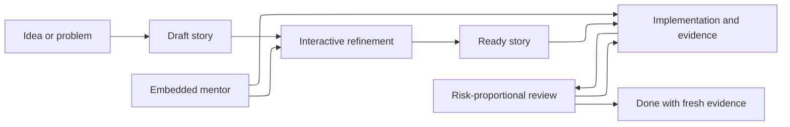

# Agentic Development Harness

## Status And Purpose

This is the active lightweight development harness for the AI robot workspace.
It adapts software-development lifecycle practices to firmware, electronics,
mechanics, and physical verification without adding team-sized ceremonies.

The canonical backlog lifecycle and transition rules live in
`../backlog/workflow.md`. The human-agent contract owns collaboration and
approval boundaries. `agentic-toolchain.md` owns executable discovery,
verification, and evidence interfaces.

## Operating Model

Use skills for repeatable work rather than persistent specialist personas:

| Skill | Responsibility |
| --- | --- |
| `refine-story` | Capture a Draft, discover context, ask consequential questions, and produce a decision-complete Ready story |
| `execute-story` | Implement a Ready story within ownership and approval boundaries, collecting claim-matched evidence |
| `review-story` | Review readiness or delivery using only the technical lenses relevant to the risk |
| `embedded-mentor` | Teach concise decision-relevant physical and real-time concepts and create useful Mermaid+ELK explanations |

A fresh isolated reviewer is useful for broad, cross-subsystem, or
safety-relevant changes. A standing fleet of firmware, electrical, mechanical,
documentation, and safety agents would duplicate context and is not justified
for the current solo project.

## Embedded Evidence Ladder

Software and physical development share specification, implementation,
testing, review, and learning loops. They differ in what evidence can support a
claim:

| Level | Can establish | Cannot establish by itself |
| --- | --- | --- |
| Static/host | Parsing, algorithms, compilation, lint, deterministic host behavior | Connected-board behavior or physical correctness |
| Runtime/simulation | Process interactions, simulated timing and failure cases | As-built wiring, voltage, fit, or real actuator behavior |
| Connected device | Firmware boot, protocol exchange, device-specific behavior | Safe energized power or motion behavior unless the scenario includes it |
| Bench/HIL | Named electrical signals, restrained actuation, stop/recovery under a controlled setup | Unrestrained ground behavior outside the setup |
| Ground motion | Integrated behavior in a qualified clear area | Behavior outside the tested configuration and conditions |

Evidence never promotes itself upward. A passing build is still a build; an
owner observation is not an instrument measurement; simulation is not as-built
qualification.

## Learning Contract

The owner is a senior software and AI engineer building deeper embedded,
electrical, and mechanical knowledge. Explanations should focus on the delta:

- define the physical or real-time concept;
- locate it in this robot and its ownership boundary;
- use a software analogy and state where the analogy fails;
- explain cause, failure mode, severity, and observable symptom;
- name an expected measurement or behavior, suitable tool, and limitation;
- link an authoritative standard, manual, datasheet, or project source;
- distinguish documentation from evidence about the installed robot.

Keep ordinary explanations short. Promote only reusable or expensive-to-relearn
concepts to `../learning/`; link canonical source material instead of copying it.

## Diagram Contract

Use Mermaid when an important flow, hierarchy, state change, timing sequence,
wiring relationship, dependency graph, or set of interacting elements is
materially easier to understand visually. Every diagram explicitly declares
`layout: elk` even when the renderer uses ELK by default. Simple local changes
need no diagram.

Mermaid diagrams explain structure; they do not replace electrical schematics,
wiring/harness drawings, mechanical drawings, timing captures, or retained
physical evidence.

## External Patterns Adapted

- [GitHub Spec Kit](https://github.com/github/spec-kit): durable feature
  specifications and measurable acceptance, reduced from many stages to Draft,
  Ready, In Progress, and Done.
- [PX4](https://github.com/PX4/PX4-Autopilot/tree/main/.agents):
  repository-owned focused skills, path-scoped instructions, and
  risk-proportional review.
- [Superpowers](https://github.com/obra/superpowers/tree/main/skills): inspect
  before asking, conversational refinement, systematic execution, and evidence
  before completion; mandatory agent fan-out omitted.
- [ArduPilot](https://github.com/ArduPilot/ardupilot/blob/master/AGENTS.md) and
  [LeRobot](https://github.com/huggingface/lerobot/blob/main/AGENTS.md): explicit
  AI accountability and separation of host, simulation, hardware, and
  live-system evidence.

Formal agent evaluation remains deferred. Start a small regression bank only
after repeated failures show which behavior needs measurement.

## Related Docs

- Backlog lifecycle: `../backlog/workflow.md`
- Human-agent contract: `human-agent-working-contract.md`
- Verification CLI: `agentic-toolchain.md`
- Skill sources: `../../.agents/skills/`
